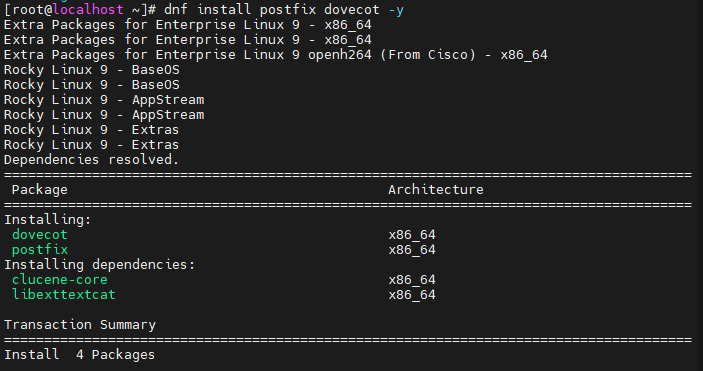
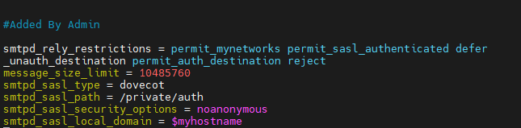
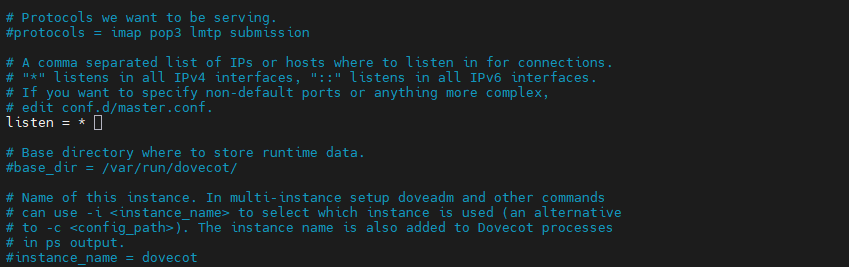
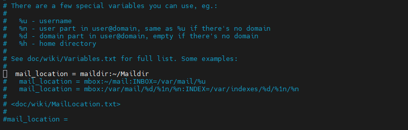
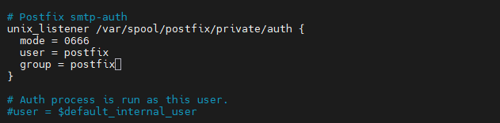
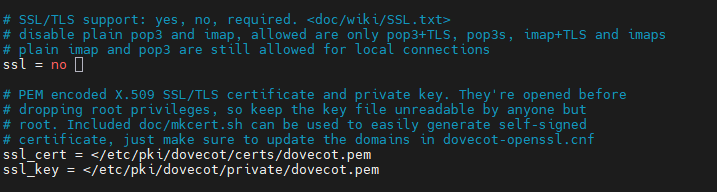

# Mail Server Installation

## Step 1: Install Postfix and Dovecot

In this step, install the Postfix and Dovecot packages on Rocky Linux / AlmaLinux using the DNF package manager.

### Command

```bash
dnf install postfix dovecot -y
```





### Description

- `dnf`: Package manager for Rocky Linux and AlmaLinux.
- `install`: Installs the specified packages.
- `postfix`: Mail Transfer Agent (MTA) responsible for SMTP mail transport.
- `dovecot`: Provides IMAP and optional POP3 services for mailbox access.
- `-y`: Automatically confirms installation prompts.

### Verify Installation

Run the following command to verify that both packages are installed:

```bash
rpm -q postfix dovecot
```

## Step 2: Configure Postfix

### 2.1 Open the Main Configuration File

Open the Postfix main configuration file using Vim:

```bash
vim /etc/postfix/main.cf
```

### 2.2 Navigate and Search in Vim

Vim provides keyboard shortcuts for navigating and editing configuration files.

| Action | Key / Command | Description |
|---|---|---|
| Go to the end of the file | `G` | Press uppercase `G` in Normal mode to move to the last line. |
| Go to the beginning of the file | `gg` | Move to the first line of the file. |
| Search for a parameter | `/parameter` | Type `/` followed by the parameter name, then press Enter. |
| Go to the next search result | `n` | Move to the next matching result. |
| Go to the previous search result | `N` | Move to the previous matching result. |
| Enter Insert mode | `i` | Start editing text at the current cursor position. |
| Return to Normal mode | `Esc` | Exit Insert mode. |
| Save and exit | `:wq` | Save the changes and quit Vim. |
| Exit without saving | `:q!` | Discard unsaved changes and quit Vim. |

**Example:** To search for `myhostname`, type `/myhostname` and press Enter. Use `n` and `N` to navigate between matching results.

### 2.3 Add Custom Configuration Parameters

Navigate to the end of the file by pressing uppercase `G`. Press `o` to create a new line below the current line and enter Insert mode.

Append the following configuration block:

```conf
# Added By Admin

smtpd_relay_restrictions = permit_mynetworks, permit_sasl_authenticated, reject_unauth_destination
message_size_limit = 10485760
smtpd_sasl_type = dovecot
smtpd_sasl_path = private/auth
smtpd_sasl_security_options = noanonymous
smtpd_sasl_local_domain = $myhostname
```

**Parameter descriptions:**

- `smtpd_relay_restrictions`: Controls which clients are allowed to relay email.
- `message_size_limit`: Sets the maximum message size to 10 MiB.
- `smtpd_sasl_type`: Specifies Dovecot as the SASL authentication provider.
- `smtpd_sasl_path`: Defines the Dovecot authentication socket path relative to the Postfix queue directory.
- `smtpd_sasl_security_options`: Disallows anonymous SASL authentication.
- `smtpd_sasl_local_domain`: Sets the local domain used for SASL authentication.




### 2.4 Update Existing Configuration Parameters

Search for each parameter using `/parameter_name`, then press Enter. Use `n` or `N` to navigate between matching results.

Modify the existing values instead of adding duplicate parameter definitions.

| Parameter | Required configuration |
|---|---|
| `mynetworks` | Specify trusted network ranges using CIDR notation. |
| `myhostname` | Set the mail server's fully qualified domain name (FQDN). |
| `mydomain` | Set the mail domain. |
| `myorigin` | Uncomment and review the existing value. |
| `mydestination` | Uncomment and review the existing value. |
| `inet_interfaces` | Set to `all` if Postfix should listen on all network interfaces. |
| `home_mailbox` | Set to `Maildir/` for Maildir mailbox delivery. |

Example configuration:

```conf
mynetworks = 127.0.0.0/8, 192.168.1.0/24
myhostname = mail.example.com
mydomain = example.com
inet_interfaces = all
home_mailbox = Maildir/
```

Replace the example IP ranges and domain names with values appropriate for your environment.

Review the existing `myorigin` and `mydestination` settings before uncommenting or modifying them. Ensure that the destination configuration matches your intended mail delivery architecture.

**Important:** Only include trusted networks in `mynetworks`. Avoid broad network ranges that could allow unauthorized clients to relay email.

### 2.5 Save and Exit Vim

After completing all modifications:

1. Press `Esc` to return to Normal mode.
2. Type `:wq`.
3. Press Enter to save the changes and exit Vim.

### 2.6 Restart and Verify Postfix

Restart the Postfix service to apply the configuration:

```bash
systemctl restart postfix
```

Check the configuration for errors:

```bash
postfix check
```

Verify the service status:

```bash
systemctl status postfix
```

If the service fails to start, inspect the logs before continuing:

```bash
journalctl -u postfix -n 50 --no-pager
```

**Note:** Postfix SMTP authentication also requires the appropriate SASL authentication settings and a matching Dovecot authentication socket configuration. These will be configured and tested in the relevant stages of this project.


## Step 3: Configure Dovecot

Dovecot provides IMAP and optional POP3 access to user mailboxes. In this step, configure its network listener, authentication, mailbox storage, authentication socket, and SSL settings.

### 3.1 Configure the Main Dovecot File

Open the main configuration file:

```bash
vim /etc/dovecot/dovecot.conf
```

Navigate to line 30:

```vim
:30
```

Press Enter, locate the `listen` parameter, and uncomment it by removing the leading `#` if present.

Set the parameter to:

```conf
listen = *
```

This allows Dovecot to listen on all IPv4 interfaces. Ensure that firewall rules restrict access to the intended networks.

Save and exit:

```vim
:wq
```

**Screenshot:** `03-dovecot-main-config.png`

Location: `config/images/03-dovecot-main-config.png`



### 3.2 Configure Authentication

Open the authentication configuration file:

```bash
vim /etc/dovecot/conf.d/10-auth.conf
```

Navigate to line 10:

```vim
:10
```

Uncomment the following parameter and set its value:

```conf
disable_plaintext_auth = no
```

Next, navigate to line 100:

```vim
:100
```

Set the authentication mechanisms:

```conf
auth_mechanisms = plain login
```

Save and exit:

```vim
:wq
```

**Parameter descriptions:**

- `disable_plaintext_auth = no`: Allows authentication without encryption. Use only in an isolated test environment; production deployments should protect authentication with TLS.
- `auth_mechanisms = plain login`: Enables the PLAIN and LOGIN SASL authentication mechanisms.

No screenshot is included for this configuration file.

### 3.3 Configure Mailbox Storage

Open the mailbox configuration file:

```bash
vim /etc/dovecot/conf.d/10-mail.conf
```

Navigate to line 24:

```vim
:24
```

Locate the `mail_location` parameter and uncomment it if necessary. Configure Maildir storage:

```conf
mail_location = maildir:~/Maildir
```

This setting stores each user's email in the `Maildir` directory inside their home directory. It should match the `home_mailbox = Maildir/` setting configured in Postfix.

Save and exit:

```vim
:wq
```

**Screenshot:** `04-dovecot-mail-config.png`

Location: `config/images/04-dovecot-mail-config.png`



### 3.4 Configure the Postfix Authentication Socket

Open the Dovecot master configuration file:

```bash
vim /etc/dovecot/conf.d/10-master.conf
```

Navigate to line 106:

```vim
:106
```

Locate the `unix_listener` configuration for `/var/spool/postfix/private/auth`. Uncomment the relevant block or add the following configuration inside the appropriate `service auth` section:

```conf
unix_listener /var/spool/postfix/private/auth {
  mode = 0660
  user = postfix
  group = postfix
}
```

This Unix socket allows Postfix to communicate with Dovecot for SASL authentication.

The socket path must match the following Postfix setting:

```conf
smtpd_sasl_path = private/auth
```

**Security note:** This example uses mode `0660` rather than `0666` to avoid granting unnecessary access to all local users. Confirm that the socket permissions and ownership work with your Postfix and Dovecot setup.

Save and exit:

```vim
:wq
```

**Screenshot:** `05-dovecot-auth-socket.png`

Location: `config/images/05-dovecot-auth-socket.png`



### 3.5 Configure SSL

Open the SSL configuration file:

```bash
vim /etc/dovecot/conf.d/10-ssl.conf
```

Locate the `ssl` parameter and set it to:

```conf
ssl = no
```

Save and exit:

```vim
:wq
```

**Important:** Disabling SSL/TLS leaves mail connections and authentication vulnerable to interception. This setting should only be used in an isolated lab environment. For an internet-facing mail server, configure TLS certificates and enable SSL/TLS before allowing real users to connect.

**Screenshot:** `06-dovecot-ssl-config.png`

Location: `config/images/06-dovecot-ssl-config.png`



### 3.6 Restart and Verify Dovecot

Restart Dovecot to apply the configuration changes:

```bash
systemctl restart dovecot
```

Check the service status:

```bash
systemctl status dovecot
```

Validate the effective configuration:

```bash
doveconf -n
```

If Dovecot fails to start, inspect the service logs:

```bash
journalctl -u dovecot -n 50 --no-pager
```

Do not proceed to mail delivery testing until Dovecot starts successfully and the configuration has been verified.


